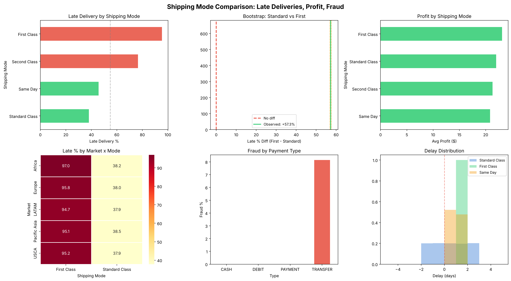
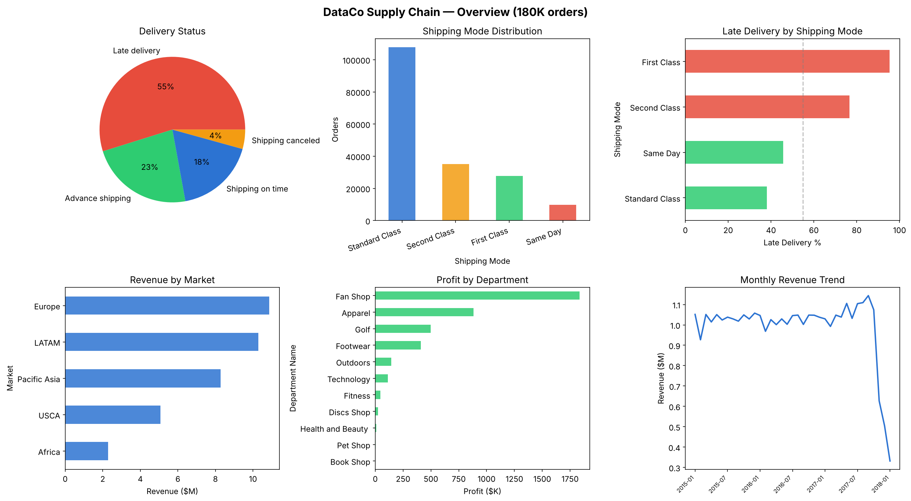
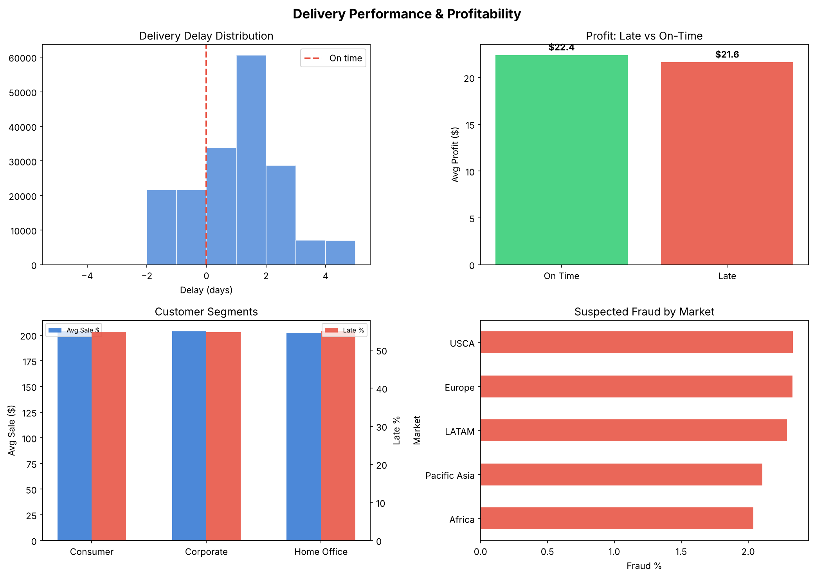

# Supply Chain Analytics — EDA, сравнение способов доставки и дашборд

> Анализ 180K заказов глобальной цепочки поставок: эффективность доставки, сравнение способов отправки, обнаружение мошенничества, Streamlit-дашборд. **Реальный датасет с Kaggle**.


**Данные**: [DataCo Smart Supply Chain (Kaggle)](https://www.kaggle.com/datasets/shashwatwork/dataco-smart-supply-chain-for-big-data-analysis)

---

## Бизнес-вопросы

1. **Почему 55% доставок опаздывают?** Какой способ отправки работает лучше?
2. **Снижает ли переход со Standard на First Class задержки?** (сравнение групп)
3. **Где сконцентрировано мошенничество?** Какие типы оплаты и рынки?
4. **Как оптимизировать прибыльность** по рынкам и департаментам?

## Датасет

180 519 заказов · 53 признака · 5 рынков · 164 страны · 4 способа отправки

| Признак | Описание |
|---------|----------|
| Shipping Mode | Standard / First / Second Class / Same Day |
| Late_delivery_risk | Бинарный: была ли доставка с опозданием? (55% = да) |
| Delivery Status | Late / Advance / On time / Canceled |
| Benefit per order | Прибыль с заказа ($) |
| Order Status | Включает SUSPECTED_FRAUD (2.2%) |
| Market | LATAM, Europe, Pacific Asia, USCA, Africa |

## Анализ

### 1. Разведочный анализ данных (`01_eda.py`)
- Эффективность доставки по рынкам и способам отправки
- Выручка и прибыльность по департаментам
- Месячные тренды, сегментация клиентов

### 2. Сравнение способов отправки (`02_ab_test.py`)
- **Standard vs First Class**: z-тест для долей, бутстрап (10 000 итераций), попарные сравнения с поправкой Бонферрони, ANOVA и Краскел–Уоллис
- **Подгрупповой анализ**: по рынкам
- **Мошенничество × тип оплаты**: хи-квадрат
- Размеры эффектов: Cohen's h и Cohen's d

> Это наблюдательное сравнение, а не рандомизированный A/B-тест: способ доставки выбирал сам клиент. Поэтому различия — это связь, а не доказанный причинный эффект.

### 3. Дашборд (`03_dashboard.py`)
5 экранов: Обзор, Доставка, A/B-тест отправки, Мошенничество, Обозреватель

## Результаты

**Главный вывод: опоздания вызваны нереалистичным обещанием срока, а не медленной доставкой.** «Опоздание» в данных — это доставка позже обещанной даты. Standard держит обещание, экспресс-тарифы — нет:

| Способ | Доля заказов | Обещано, дн. | Фактически, дн. | Опоздания |
|:--|--:|--:|--:|--:|
| Standard Class | 60% | 4 | 4,0 | 38,1% |
| Same Day | 5% | 0 | 0,5 | 45,7% |
| Second Class | 20% | 2 | 4,0 | 76,6% |
| First Class | 15% | 1 | 2,0 | 95,3% |



**Standard vs First Class.** У First Class опозданий на 57,3 п.п. больше (95,3% против 38,1%; z = 170, p < 0,001; бутстрап 95% ДИ: +56,9…+57,6 п.п.; Cohen's h = 1,38). Эффект одинаков во всех 5 рынках (+56,6…+58,8 п.п.). Прибыль с заказа не отличается значимо ($23,12 против $22,00; p = 0,10).

**Мошенничество.** 2,2% заказов помечены как подозрительные, и все они оплачены переводом (TRANSFER: 8,1%, остальные типы: 0%; χ² = 10 883, p < 0,001). По рынкам доля ровная: 2,0–2,3%.

**Рекомендации**
1. Не переводить заказы на First Class: опозданий станет больше, а не меньше.
2. Пересчитать обещанный срок для First и Second Class (сейчас 1 и 2 дня при фактических 2 и 4) или исправить операционный процесс — это снимет основную массу «опозданий».
3. Добавить дополнительную проверку для оплаты переводом: на неё приходится 100% подозрительных заказов.

### Обзор данных





> Резкое падение выручки с октября 2017 года — особенность выгрузки (неполные данные за последние месяцы), а не реальный спад; при анализе трендов эти месяцы стоит исключать.

## Быстрый старт

Скачайте `DataCoSupplyChainDataset.csv` с [Kaggle](https://www.kaggle.com/datasets/shashwatwork/dataco-smart-supply-chain-for-big-data-analysis) и положите в папку `data/`.

```bash
pip install -r requirements.txt
python src/01_eda.py
python src/02_ab_test.py
streamlit run src/03_dashboard.py
```

## Структура проекта

```
supply-chain-analytics/
├── data/DataCoSupplyChainDataset.csv  # 180K заказов (Kaggle)
├── src/
│   ├── 01_eda.py
│   ├── 02_ab_test.py
│   └── 03_dashboard.py
├── output/plots/
├── requirements.txt
└── README.md
```
